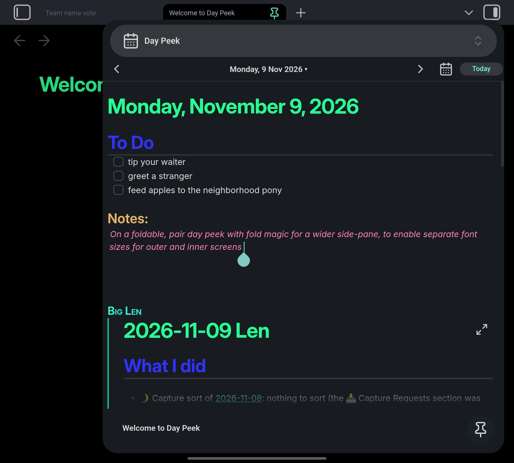

# Fold Magic

An Obsidian plugin that fixes Obsidian mobile's bugs on **book-style foldable phones** (a cover screen outside, a big screen inside, like the Galaxy Z Fold). Turn it on and fold away.

Made by **Tailnet 4**.

## What Fold Magic does

- **Separate font sizes for each screen.** Set one size for the outer screen and another for the inner screen, so text looks right whether you're folded or unfolded.
- **Wider side panes.** Set your own sidebar width for each screen, so the drawer can actually use the big screen.
- **Fixes the stuck layout bug.** Obsidian can get stuck squashed into part of the screen after you fold or unfold. Fold Magic fixes it automatically or with one tap.
- **Hide the Android status bar.** Automatically or with a gesture, for a cleaner full screen.

## Screenshot

Unfolded Galaxy Z Fold 7 with the sidebar widened by Fold Magic (here showing [Day Peek](https://github.com/SnakeJaeger/day-peek)):

## In detail

- **Un-sticks the layout after folding.** Obsidian sometimes keeps the old layout when you fold or unfold, for example with a sidebar open: the main view stays shoved to one side, with black next to it. Fold Magic checks the layout after every fold, sidebar change and app resume, and fixes it:
  - it clears the leftover "slide aside" offset on the main view (the usual cause);
  - it closes a sidebar that's stuck half-way;
  - it re-runs Obsidian's own phone/tablet switch, which Obsidian skips while the keyboard is up.

  If none of that helps, a ✨ **Fix layout** button appears in the note header, left of the reading-view icon. Tapping it closes the sidebars and resets the layout first; only if that isn't enough does it save your open notes and reload Obsidian (if something can't be saved, it doesn't reload and tells you). You can also keep the button there all the time, do nothing, or let Fold Magic reload automatically: that happens at most once every 5 minutes and only right after a fold, so a misreading can never trap you in a reload loop.
- **Android status bar.** The command *Toggle Android status bar* works any time; bind it to the pull-down gesture in Settings → Mobile → Quick action. There's also an optional auto-hide: always, only unfolded, or only folded. It works together with [Day Peek](https://github.com/SnakeJaeger/day-peek): both use one shared controller for the bar, so they never fight over it.
- **Sidebar width, folded and unfolded.** Obsidian limits the slide-out sidebar to 84% of the screen and at most 450 px, so unfolded it only fills about half the screen. Set a width for the outer and inner screen, plus a pinned sidebar width for the inner screen; they switch by themselves when you fold. Whatever you type is the width you get: Fold Magic lifts the 450 px cap for you (an *Advanced* section lets you set your own maximum). While you type in a width field, it shows your current screen width.
- **Note font size, folded and unfolded.** A foldable's inner screen usually has a lower pixel density than the cover screen, so the same font size looks bigger unfolded (about 15% on a Z Fold 7: roughly 370 vs 420 ppi). Set one size for each state; it switches by itself. Leave a size empty to use your Appearance size, and turning the plugin off puts that back. While a size is set here, it wins over pinch-to-zoom.
- **Troubleshooting.** *Log screen changes* writes one line per fold to a note. The command *Save a layout snapshot* records the full layout, including the keyboard toolbar.

**Which phones:** Fold Magic tells folded from unfolded the same way Obsidian picks its phone and tablet layouts: a screen at least 600 px wide *and* 600 px tall counts as unfolded. That fits book-style foldables. On flip phones (Z Flip and similar) both screens count as "phone", so only the Folded settings apply. Split screen or a pop-up window on the inner screen counts as folded.

Fold Magic does nothing on desktop. Turning it off or updating it puts the status bar, widths and font size back to stock.

## Common foldable screen widths

Widths are in **CSS pixels**, the units the width settings use. They're smaller than the phone's spec-sheet resolution, and they change with the display size setting (Settings → Display → Screen zoom). The quickest way to know yours: tap into a width field in Fold Magic's settings; it shows your current width while you type.

| Phone | Folded (cover) | Unfolded (inner) | Source |
|---|---|---|---|
| Samsung Galaxy Z Fold 7 | 411 × 960 | 749 × 832 | measured in Obsidian with Fold Magic (default zoom) |

Heights in Obsidian are a little smaller than the full screen, because of the status and navigation bars. Got another foldable? Run *Save a layout snapshot* and send us the numbers.

**Tip:** for a sidebar that's wide but leaves a sliver of your note visible, use about the unfolded width minus 50 px. On the Fold 7 that's around `700px`.

## Settings

| Setting | Options |
|---|---|
| When the layout gets stuck after folding | Do nothing · Show Fix layout button when stuck · Always show Fix layout button · Reload automatically |
| Close sidebars when you fold or unfold | On / off |
| Android status bar: hide automatically | Never · Always · When unfolded · When folded |
| Sidebar width | Folded (outer screen) width · Unfolded (inner screen) width · Unfolded (inner screen) pinned sidebar width; any CSS length |
| Sidebar width → Advanced (collapsed) | Folded (outer screen) max width · Unfolded (inner screen) max width; empty = no cap when a width is set |
| Note font size | Folded (outer screen) · Unfolded (inner screen), e.g. `16` and `14` (px); empty = your Appearance size |
| Log screen changes / Log note | On / off, path of the note |

## Got a foldable?

Fold Magic was built and tested on a Galaxy Z Fold 7. If you're on a different foldable and something's off, or there's a feature you'd like, [open an issue on GitHub](https://github.com/SnakeJaeger/fold-magic/issues) and let us know. No promises, but we'll see what Big Len can do.

## Good to know

Fold Magic reads and adjusts Obsidian's own layout. The phone/tablet rule `(min-width: 600px) and (min-height: 600px)` and the `--mobile-sidebar-*` CSS variables are Obsidian internals, so a big Obsidian update could change them.

No build step: `main.js` is plain JavaScript.

## License

[MIT](LICENSE) © 2026 Tailnet 4
